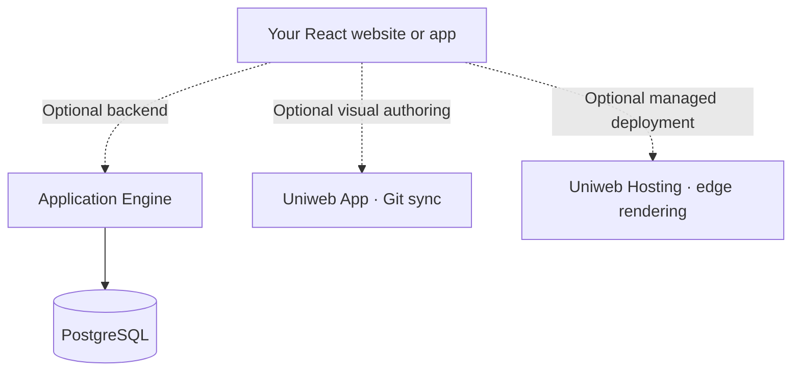

[](https://discord.gg/TkmkA5vH)
[](https://twitter.com/uniwebcms)
[](https://www.npmjs.com/package/uniweb)
[](LICENSE)

# Uniweb

### Build websites and web apps. Leave the backend to Uniweb.

**Build in React. Edit visually. Sync through Git.**

Uniweb is an open-source React framework and part of an integrated platform for building, editing, and running web applications. Create your own components and data models. Use a visual editor for content, and an **Application Engine** for the common backend capabilities you would otherwise have to build yourself.

[**Website**](https://uniweb.io) · [**Documentation**](https://uniweb.io/docs) · [**Developer CLI**](https://github.com/uniweb/cli) · [**Visual App**](https://www.uniweb.app) · [**Discord**](https://discord.gg/TkmkA5vH)

## Start with an AI agent—or your editor

Give this to Claude Code, Codex, Cursor, or another coding agent:

```text
Build a website or web app with Uniweb.
Start with `npx uniweb@latest start`

I want to build: [describe your website or web app]
```

Or start directly in your terminal:

```bash
npx uniweb@latest create
```

Uniweb projects are normal React projects. Work with Vite, files, and Git; use the CLI to inspect, validate, synchronize, and publish. Agents can follow `AGENTS.md` and Markdown documentation, but the resulting code is yours to maintain.

## One platform, four cooperating parts

| | What it provides |
| --- | --- |
| **[Framework](https://github.com/uniweb/cli)** | React components, structured content, schemas, Vite and Git-based development. Open source. |
| **[Backend](https://uniweb.io/backend)** | The Application Engine written in Rust. Generic entity storage, typed references, identity, permissions, and common backend services. The backend is based on our open-source [Actus](https://crates.io/crates/actus) web framework. |
| **[Frontend](https://www.uniweb.app)** | CMS and visual website composer. Editing controls derived from your components and schemas. Authors work in the browser while developers keep working in Git. It syncs content and schemas with your git project. It previews with your code. |
| **[Hosting](https://uniweb.io)** | Managed hosting at the edge. Publishing, edge delivery, just-in-time rendering, and dedicated application backends when needed. |

The framework can also be used without the managed platform. Static or dynamic sites don't need a dedicated backend. For application development, the open-source [`@uniweb/api`](https://github.com/uniweb/api) includes a Node.js mock backend; the real Application Engine is available through Uniweb's managed infrastructure.

## What makes <ins>Uniweb Framework</ins> different?

Uniweb is an open-source React framework and a connected visual authoring platform.

Developers build real React components, schemas, and content structures in a normal codebase. Those definitions become the vocabulary authors use to create pages, manage content, and work with structured data.

**Developers define the vocabulary. Authors compose with it. Uniweb keeps both sides in sync.**

**Traditional**

```text
developer builds → hands off → CMS users edit
```

**Uniweb**

```text
developer project ⇄ Uniweb ⇄ author workspace
       ↑                         ↑
       └──── both keep working ──┘
```

**Start with a normal project. Connect the authoring environment when you want it.**

```bash
# Create a project
npx uniweb create

# Sign in when you want visual authoring
pnpm uniweb login

# Sync the project with the author workspace
pnpm uniweb sync
```

### Components become an authoring vocabulary

A component can have two interfaces.

For a developer:

```jsx
<Hero />
<FeatureGrid />
<PublicationList />
<Team />
```

For an author, those same components become meaningful building blocks:

| Component | What an author works with |
| --- | --- |
| **Hero** | Heading · Image · Call to action · Layout |
| **Publication List** | Source · Filters · Sorting · Presentation |
| **Team** | People · Roles · Grouping · Style |

The author doesn't manipulate JSX, HTML, or arbitrary layout primitives. The developer doesn't build a separate editing UI for every section of the site.

> **You build the components. Uniweb builds the authoring experience.**

## What makes <ins>Uniweb Backend</ins> different?

Game developers use engines so they don't rebuild rendering, physics, and other shared systems for every game. Web applications share a lot of machinery too.

**An Application Engine is a reusable layer above the database.** It handles structured entities, relationships, persistence, identity, access control, and other common services. You define your domain and what makes your application different.

In Uniweb, that engine is a proprietary Rust server backed by PostgreSQL. It is distinct from the open-source React framework. Every solution using Uniweb's managed backend gets its own backend deployment and PostgreSQL database.



The backend doesn't have to execute every piece of application logic. Many calculations, transformations, and document-generation tasks can run in the browser. When trusted server-side computation is necessary, Uniweb's managed platform supports JavaScript functions on Cloudflare Workers; specialized workloads can use external services.

If you're familiar with backend-as-a-service products such as Supabase, the distinction is **where the abstraction starts**: Uniweb provides a domain-oriented application model and reusable backend mechanisms above PostgreSQL, rather than making database tables the primary application interface.

## Explore the open-source projects

- **[Uniweb CLI](https://github.com/uniweb/cli)** — Project creation, local development, validation, Git synchronization, and publishing.
- **[Uniweb API](https://github.com/uniweb/api)** — Client API and local mock backend for applications.
- **[Actus](https://crates.io/crates/actus)** — Our open-source Rust web framework, used to build the Uniweb Application Engine.
- **[All Uniweb repositories](https://github.com/uniweb?tab=repositories)** — Framework packages, tooling, and supporting libraries.

The Uniweb framework and its open-source tooling are licensed under **Apache 2.0**. The Uniweb backend (Application Engine) is proprietary. Uniweb is developed by [Proximify](https://proximify.com).

[Website](https://uniweb.io) · [Discord](https://discord.gg/TkmkA5vH) · [X](https://x.com/uniwebcms)
